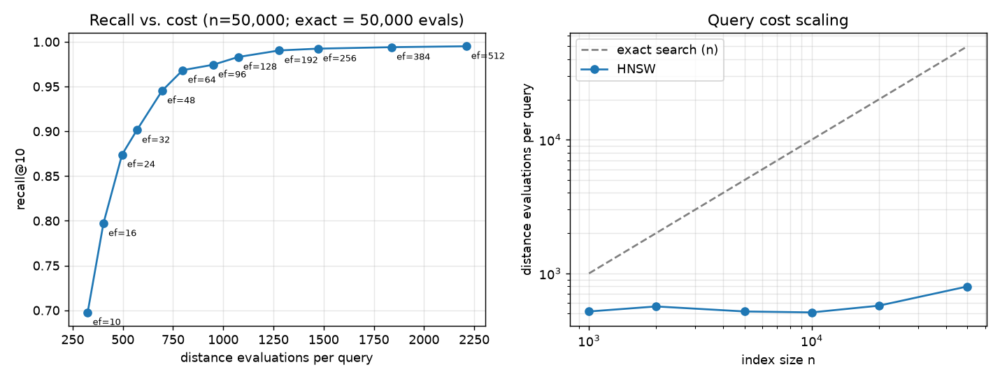

# hnsw-lite
[](https://github.com/venu-yara/hnsw-lite/actions/workflows/ci.yml)

A from-scratch implementation of **HNSW** (Hierarchical Navigable Small World graphs), the
approximate nearest-neighbor algorithm behind most vector databases (pgvector, OpenSearch,
Weaviate, Qdrant, FAISS's `IndexHNSW`), in ~400 lines of Python + NumPy, with a test suite
and a reproducible benchmark against exact search.

The goal is not to beat `hnswlib`. It is to make the algorithm and its trade-offs
**visible and measurable**: every query reports how many distance computations it cost,
so you can see exactly what the graph buys you over brute force.



**Headline (50,000 × 64-d vectors, overlapping clusters):** recall@10 = **0.97** while
computing distances to only **1.6 %** of the dataset per query (798 vs. 50,000).
At 0.995 recall it still touches only 4.4 %.

## Quickstart

```bash
pip install -e ".[dev,bench]"
pytest                                  # 20 tests, ~10 s
python bench/run_benchmark.py           # ~1 min, writes bench/results.{md,json,png}
```

```python
import numpy as np
from hnswlite import HNSWIndex

vectors = np.random.rand(10_000, 128).astype("float32")
index = HNSWIndex(dim=128, metric="cosine", M=16, ef_construction=200, seed=0)
index.add(vectors)                       # labels default to 0..n-1; or pass labels=[...]

labels, distances = index.search(vectors[0], k=10, ef=64)
index.delete(42)                         # tombstone: never returned again
index.save("index.npz")
index = HNSWIndex.load("index.npz")      # no pickle: loading cannot execute code
```

## How it works

```
layer 2   o-----------------------o                   few nodes, long edges
          |                       |                   -> coarse, fast navigation
layer 1   o------o--------o-------o------o
          |      |        |       |      |
layer 0   o-o-o--o-o-o-o--o-o-o-o-o-o-o--o-o-o        every node, short edges
                                                      -> fine-grained local search
```

1. **Layer assignment.** Each inserted vector draws a level `floor(-ln(U) · mL)` with
   `mL = 1/ln(M)`, so P(level ≥ l) = M^-l. That gives a skip-list-like hierarchy. A test
   checks the distribution empirically.
2. **Search** starts at the single top-layer entry point and **greedily hill-climbs**
   down through the upper layers (beam width 1), using each layer's local minimum as the
   entry to the next. On layer 0 it runs a **beam search** with width `ef`: a min-heap
   of candidates to expand and a max-heap of the best `ef` results, stopping once the
   nearest unexpanded candidate is farther than the worst result.
3. **Insertion** runs the same search for the new vector, then links it to `M`
   neighbors on every layer it lives in, adding back-edges. If that pushes a neighbor
   past its degree cap (`M`, or `2M` on layer 0), the neighbor's list is re-pruned.
4. **Neighbor selection heuristic** (paper's Algorithm 4). Taking the `M` closest
   candidates is not enough. On clustered data they all point into the same cluster,
   and the graph splits into islands. Instead a candidate is kept only if it is
   **closer to the new node than to any neighbor already kept**. Redundant edges are
   dropped, and the edges that bridge clusters survive. A test checks that layer 0
   stays connected.

## Engineering decisions

| Decision | Why |
|---|---|
| Vectors in one contiguous `float32` array, grown by doubling | Expanding a node computes distances to all its neighbors in **one** vectorized NumPy call instead of a Python loop. This is the main reason pure Python is usable here. |
| Pairwise distance matrix for the pruning heuristic | The O(M²) "closer to me than to any kept neighbor" check becomes one matrix multiply plus cheap lookups. |
| `distance_count` instrumentation | Wall-clock time in Python mostly measures the interpreter. Distance evaluations measure the **algorithm** and carry over to any implementation language. |
| Tombstone deletes | Physically removing a node would break routes that pass through it. Deleted nodes keep routing but are never added to the result heap, so you still get `k` live results. A test deletes 90 % of the index and checks recall on the survivors. |
| `np.savez` + JSON metadata, `allow_pickle=False` | Index files may come from untrusted places. Pickle would allow arbitrary code execution on load. |
| Seeded RNG | Same seed + same inserts give a bit-identical graph, so tests and benchmarks are reproducible. |

## Benchmarks

`python bench/run_benchmark.py` builds the index, sweeps `ef_search`, and compares
against exact brute-force k-NN (ground truth). M=16, ef_construction=100, k=10, 300 queries,
in a single Python process on a Windows Server VM (Python 3.12, NumPy 2.5).

**Overlapping Gaussian clusters, n = 50,000, dim = 64** (a rough stand-in for embeddings;
full table: [bench/clustered.md](bench/clustered.md))

| ef_search | recall@10 | distance evals / query | % of exact | latency |
|---:|---:|---:|---:|---:|
| 16 | 0.797 | 403 | 0.8 % | 0.24 ms |
| 32 | 0.901 | 570 | 1.1 % | 0.37 ms |
| 64 | 0.968 | 798 | 1.6 % | 0.62 ms |
| 128 | 0.983 | 1,075 | 2.2 % | 0.99 ms |
| 512 | 0.995 | 2,210 | 4.4 % | 2.79 ms |
| exact | 1.000 | 50,000 | 100 % | 0.78 ms |

**Uniform random noise, n = 20,000, dim = 64** (worst case; [bench/uniform.md](bench/uniform.md))

| ef_search | recall@10 | distance evals / query | % of exact |
|---:|---:|---:|---:|
| 64 | 0.757 | 1,632 | 8.2 % |
| 256 | 0.980 | 4,798 | 24.0 % |
| 512 | 0.997 | 7,732 | 38.7 % |

### What the numbers do and don't say

- **Query cost is nearly flat in n.** From 1k to 50k vectors, a query at ef=64 goes from
  ~520 to ~800 distance evaluations, while exact search grows 50×. Caveat: ef is fixed in
  that sweep, so recall slips slightly with n (0.998 → 0.968). The comparison is not at
  equal recall.
- **Wall-clock is honest, not flattering.** At 50k vectors, NumPy brute force (one BLAS
  matrix-vector product) is about as fast as interpreted HNSW at ef=64. HNSW does ~60×
  less arithmetic, but each step pays Python overhead. The crossover moves in HNSW's
  favor as n grows: brute force is O(n), and HNSW is roughly O(log n). A compiled core would
  win at any realistic size.
- **Uniform noise is the worst case**, and the benchmark shows it on purpose. With no
  low-dimensional structure, "nearest" and "far" distances concentrate (the curse of
  dimensionality), and the graph needs far more work for the same recall. Real embeddings
  sit much closer to the clustered case.
- **Synthetic data.** To run on real data, pass TEXMEX `.fvecs` files (e.g. SIFT1M) or
  `.npy`: `python bench/run_benchmark.py --data sift_base.fvecs --queries sift_query.fvecs`.

## Tests

`pytest` covers:

- **Correctness against ground truth:** recall ≥ 0.95 for both metrics, exact
  distances match brute force, results sorted and unique.
- **Graph invariants:** degree caps per layer, no self-loops or duplicate edges, edges
  only to nodes present on that layer, entry point is on the top layer, layer 0 is
  connected.
- **Statistics:** the level distribution matches P(level ≥ 1) = 1/M.
- **Lifecycle:** delete / re-add with the same label, deleting 90 % of the index, save →
  load → identical results → keep inserting.
- **Edge cases and validation:** empty index, k > n, padding in batch search, NaN,
  zero vectors under cosine, dimension mismatch, duplicate labels, deterministic builds.

## Limitations and next steps

- **Single-threaded, pure Python.** The obvious next step is a C++ (pybind11) or Rust (PyO3)
  core for `search_layer`. The Python version stays as the readable reference and the
  test oracle.
- **Deletes are never compacted.** Heavy churn leaves dead nodes routing traffic. Fix:
  periodically repair the neighbors of tombstoned nodes, as hnswlib's `markDelete` +
  `replace_deleted` does, or rebuild.
- **No filtered search.** Metadata filters ("only docs this user may see") interact badly
  with graph search. Post-filtering loses recall, and pre-filtering breaks connectivity. This
  is a known hard problem in RAG systems and the most interesting extension.
- **Hybrid retrieval.** Combine with a BM25 inverted index via reciprocal-rank fusion.

## References

- Y. Malkov, D. Yashunin. *Efficient and robust approximate nearest neighbor search using
  Hierarchical Navigable Small World graphs.* IEEE TPAMI, 2018. [arXiv:1603.09320](https://arxiv.org/abs/1603.09320)
- [hnswlib](https://github.com/nmslib/hnswlib), the reference C++ implementation; its conventions (M neighbors per layer, 2M cap on layer 0, no kept pruned connections) are followed here.
- [ann-benchmarks](https://ann-benchmarks.com), standard methodology for recall vs. throughput.
